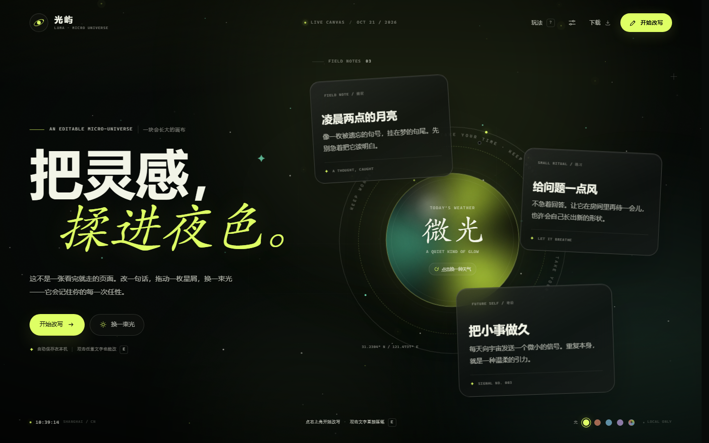

# 光屿 LUMA · 一块会长大的灵感画布

一个可以直接在浏览器里打开的互动页面：有星尘、有光核、有三枚可以移动的「星屑」，而且标题、正文和卡片都可以随手改写。

它没有框架、没有依赖、没有外部字体或图片。直接双击 `index.html` 就能打开（推荐 Chrome / Edge）。



## 可以玩什么

- **直接改写**：点「开始改写」后，标题、开场白、每张星屑的标题和正文都能直接输入；双击任意文字也能直接进入编辑。
- **移动星屑**：在桌面上，拖动卡片右上角的六点手柄，随便把它放到哪里。工具栏里还有「换一阵风」和「归位」。
- **点击光核**：切换「微光 / 潮汐 / 失重 / 回响」四种今日天气，并触发一小簇星尘。
- **换一束光**：四套主题，或通过调色盘里的 `+` 自选一种颜色。
- **调整画布**：右上角设置里有星尘速度、胶片颗粒、星尘开关和光晕跟随。
- **自动保存**：所有文字、位置和设置只保存在当前浏览器的 `localStorage` 中，不上传任何地方。
- **带走作品**：可以导出 JSON 源文件、重新导入，或者生成一张 1600px 的 PNG 海报。
- **移动端**：手机上的星屑会自动排成一条可读的星轨，编辑工具栏固定在底部。

## 快捷键

| 按键 | 动作 |
| --- | --- |
| `E` | 进入 / 退出编辑 |
| `T` | 换一束光 |
| `?` | 打开玩法说明 |
| `Ctrl / Cmd + S` | 保存到本机 |
| `Esc` | 关闭菜单 / 设置 / 弹窗，或退出当前输入框 |

## 文件结构

```text
index.html          页面结构与文案
styles.css          视觉、动效、响应式布局
app.js              编辑、拖拽、存读、主题、光核、海报导出
previews/           桌面、手机与海报预览图
```

## 想自己改

- 默认文案：`app.js` 里的 `DEFAULT_HERO`、`DEFAULT_NOTES`。
- 主题光色：`app.js` 里的 `THEMES`；也可以只改 CSS 顶部的 `--accent`、`--accent-2` 等变量。
- 今日天气：`app.js` 里的 `MOODS`。
- 新增星屑的占位提示：`NEW_NOTE_PRESETS`。
- 卡片、标题、光核的全部视觉都在 `styles.css`，关键的媒体查询断点为 `900px` 和 `640px`。

## 数据说明

- 存储键名：`luma-canvas-v1`。
- 清除浏览器站点数据，或点设置里的「恢复初始」，都会让画布回到最初的内容。
- 如果浏览器禁用了本地存储，页面依旧可以玩，但刷新后不会记住改动。
